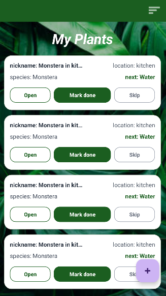
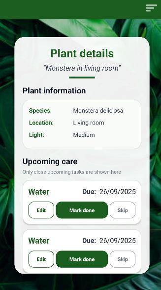
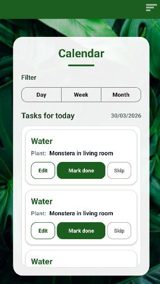

<p align="center">
  
</p>

<h1 align="center">Green Thumb</h1>

<p align="center">
  A personal companion for healthier houseplants.<br>
  Discover species, plan care, and follow your plants' progress in one Android app.
</p>

<p align="center">
  <a href="https://developer.android.com"></a>
  
  
  <a href="LICENSE"></a>
</p>

<p align="center">
  <a href="#features">Features</a> ·
  <a href="#screenshots">Screenshots</a> ·
  <a href="#getting-started">Getting started</a> ·
  <a href="docs/ARCHITECTURE.md">Architecture</a> ·
  <a href="CONTRIBUTING.md">Contributing</a>
</p>

## Why Green Thumb?

Green Thumb began with a familiar problem: bringing new plants home, then struggling to keep them healthy without clear care instructions or a reliable routine. It brings plant information, recurring tasks, reminders, and a care journal together so beginners and plant enthusiasts can keep track of what each plant needs.

Developed by [Yoav Solar](https://github.com/Yoavsol), Green Thumb also gives gardening content creators a place to publish guides and follow reader engagement. This repository contains the Android source; running it requires configuring the external services described below.

## Features

| Feature | What you can do |
| --- | --- |
| **Species discovery** | Browse and search plant species through the Perenual API, including a guest experience before signing in. |
| **Personal plant collection** | Add plants with a nickname, species, location, and care information. |
| **Recurring care plans** | Schedule watering, fertilizing, spraying, pruning, and repotting; edit tasks and mark them done or skipped. |
| **Care calendar** | Review upcoming tasks by day, week, or month. |
| **Local reminders** | Configure reminder time, enable notifications, and snooze care alerts. |
| **Plant history** | Keep text notes, photos from the camera or gallery, and a record of care activity. |
| **Community guides** | Read guides, leave comments, like posts, and submit ratings. Content creators can publish guides and view engagement statistics. |
| **AI assistant** | Ask general or plant-specific questions, attach a plant photo, and continue a conversation powered by Google Gemini. |

## Screenshots

<table>
  <tr>
    <th>My plants</th>
    <th>Plant details</th>
    <th>Care calendar</th>
  </tr>
  <tr>
    <td></td>
    <td></td>
    <td></td>
  </tr>
</table>

Example screenshots with demonstration plant data. See [image provenance](docs/images/README.md).

## Getting started

### Prerequisites

- Android Studio with support for Android Gradle Plugin **8.13.1**.
- Android SDK **36** and an Android **8.0 / API 26** or newer device or emulator.
- A Gradle runtime compatible with the checked-in daemon configuration, which selects **JetBrains JDK 21**. The Java source and target compatibility are **17**.
- Your own Firebase project, a Perenual API key, and a Gemini API key for the features you want to use.

### Install and run

1. Clone the repository:

   ```bash
   git clone https://github.com/Yoavsol/GREEN_THUMB.git
   cd GREEN_THUMB
   ```

2. Open the project root in Android Studio.
3. Follow the [setup guide](docs/SETUP.md) to configure your Firebase backend and local API keys. The versioned Firebase configuration points to the original project; replace it with your own configuration for development.
4. Sync Gradle, select the **app** run configuration, and run on your device or emulator.

Once configured, you can build a debug APK from the project root:

```bash
./gradlew :app:assembleDebug
```

On Windows, use `gradlew.bat :app:assembleDebug`. The APK is written to `app/build/outputs/apk/debug/app-debug.apk`.

**First walkthrough:** browse species as a guest, register a test account, add a plant, choose its care schedule, and open the calendar. Add a history note or photo, then try the guides and AI assistant. Register as a **Content creator** to explore guide publishing and analytics.

## Built with

| Area | Technologies |
| --- | --- |
| Android UI | Java, XML layouts, View Binding, AndroidX, Material Components, RecyclerView |
| App architecture | MVVM, ViewModel, LiveData, five Gradle modules |
| Cloud data and images | Firebase Cloud Firestore and Cloud Storage |
| Plant information | Perenual API, Retrofit, Gson, OkHttp |
| AI assistance | Google Gemini, Generative AI Android SDK, Guava futures |
| Device features | AlarmManager, local notifications, camera/gallery integration, FileProvider |
| Build | Gradle 8.13, Android Gradle Plugin 8.13.1, Kotlin DSL build scripts |

The application code is Java; Kotlin DSL is used for the Gradle configuration.

## Project structure

```text
GREEN_THUMB/
├── app/          Android screens, layouts, adapters, and notifications
├── VIEWMODEL/    Observable screen state and application actions
├── REPOSITORY/   Firestore, image storage, Perenual, and Gemini integrations
├── MODEL/        Users, plants, care tasks, guides, and other domain entities
├── HELPER/       Shared validation, date, image, and UI utilities
├── docs/         Setup, architecture, and example screenshots
└── gradle/       Wrapper, dependency catalog, and JVM configuration
```

Read the [architecture guide](docs/ARCHITECTURE.md) for module dependencies, data relationships, and the care-task lifecycle.

## Project scope

Green Thumb brings plant discovery, care scheduling, reminders, journaling, community guides, and AI assistance into one application.

This repository includes the application source, architecture documentation, and development setup instructions. To run your own copy, configure Firebase, Perenual, and Gemini as described in the [setup guide](docs/SETUP.md). Features using external services depend on the providers’ availability, access, and usage limits.

## Contributing

Bug reports, documentation improvements, and focused pull requests are welcome. Read [CONTRIBUTING.md](CONTRIBUTING.md) for setup, validation, and commit-message guidance, or [open an issue](https://github.com/Yoavsol/GREEN_THUMB/issues/new/choose).

## Author and license

Created by **[Yoav Solar](https://github.com/Yoavsol)**.

Green Thumb is available under the [MIT License](LICENSE). Third-party libraries, services, and externally sourced plant data or images retain their own licenses and terms.
