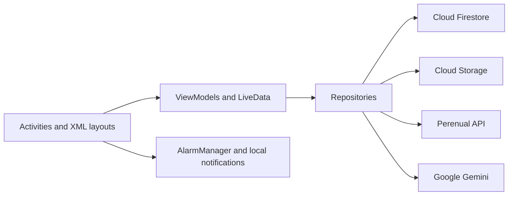
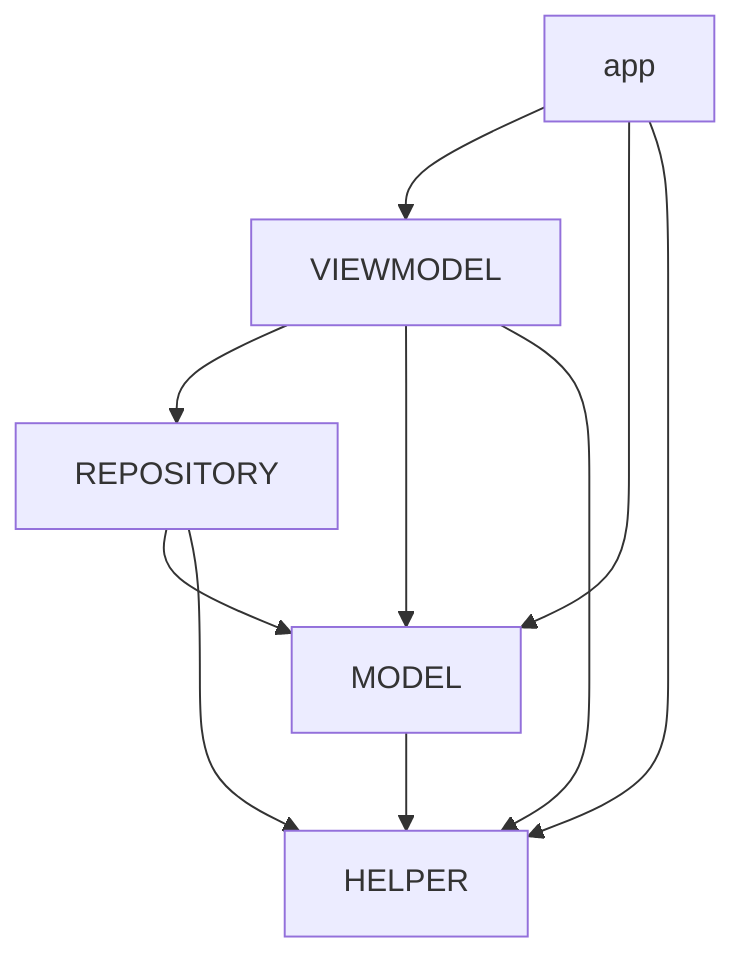
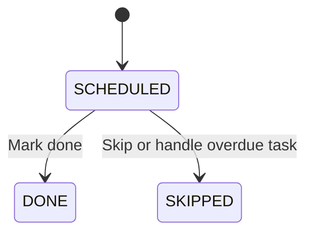

# Architecture

[Back to the README](../README.md) · [Development setup](SETUP.md)

Green Thumb is organized into five Android Gradle modules around an MVVM approach. Activities render screens and handle user interactions, ViewModels expose observable state and actions, and repositories communicate with cloud services. Shared model and helper classes support these layers.

## Main data flow

This diagram describes the main flow, rather than a strict dependency boundary: some Activities also access Firestore directly, and Firebase types appear in domain entities.

## Modules

| Module | Responsibility | Examples |
| --- | --- | --- |
| [`app`](../app/src/main/java/com/yoav_s/tashtit) | Activities, XML layouts, list adapters, navigation, and notification scheduling | `MyPlantsActivity`, `CalendarActivity`, `AIAssistantActivity`, `TaskNotificationScheduler` |
| [`VIEWMODEL`](../VIEWMODEL/src/main/java/com/yoav_s/viewmodel) | LiveData state, screen actions, repository orchestration, and AI loading/error state | `BaseViewModel`, `PlantsViewModel`, `SpeciesApiViewModel`, `AskAiViewModel` |
| [`REPOSITORY`](../REPOSITORY/src/main/java/com/yoav_s/repository) | Firestore access, image storage, external API mapping, and AI provider integration | `BaseRepository`, `CareTasksRepository`, `SpeciesApiRepository`, `GeminiRepository` |
| [`MODEL`](../MODEL/src/main/java/com/yoav_s/model) | Domain entities, enums, and typed collections | `User`, `Plant`, `Specie`, `CareTask`, `HistoryNote`, `Guide` |
| [`HELPER`](../HELPER/src/main/java/com/yoav_s/helper) | Reusable date, image, validation, preference, and UI helpers | `DateUtil`, `BitMapHelper`, `Validator`, `LoginPreference` |

### Gradle project dependencies

These are the project-to-project dependencies declared in the module build files:

## Domain and persistence

[BaseEntity](../MODEL/src/main/java/com/yoav_s/model/BASE/BaseEntity.java) provides common identity fields. Typed collection classes extend `BaseList`, and [BaseRepository](../REPOSITORY/src/main/java/com/yoav_s/repository/BASE/DB/BaseRepository.java) uses the collection class's simple name as its Firestore collection name. It supplies shared create, update, delete, query, snapshot-listener, and optional image-handling operations.

| Collection | Purpose and relationships |
| --- | --- |
| `Users` | Display name, email, password hash, and `USER` or `CONTENT_CREATOR` role. |
| `Plants` | Personal plants associated with `userId`, with a nickname, species information, and location. |
| `Species` | Stored species entities. External species discovery is handled separately by Perenual. |
| `CareTasks` | Tasks associated with `plantId`, including type, recurrence interval, due date, and state. |
| `HistoryNotes` | Plant notes and care-history entries, with optional photos and timestamps. |
| `Guides` | Published content associated with `contentCreatorId`, plus engagement summary fields. |
| `GuideInteractions` | Reader comments, likes, and ratings associated with `guideId` and `userId`. |
| `Settings` | Per-user reminder time, snooze duration, and notification preferences. |
| `Reminders` | Reminder entities; local scheduling also derives data from settings, plants, and care tasks. |

Photos are handled through [FirebaseImageStorage](../REPOSITORY/src/main/java/com/yoav_s/repository/BASE/DB/FirebaseImageStorage.java); the shared repository picture helpers use paths under `images/<collection name>` with entity document IDs.

## Care-task lifecycle

[CareTask](../MODEL/src/main/java/com/yoav_s/model/CareTask.java) defines five care types: `WATER`, `FERTILIZE`, `SPRAY`, `PRUNE`, and `REPOT`. A task stores `plantId`, `everyDays`, `nextDueAt`, `doneAt`, and a state:

The completed or skipped task remains a historical occurrence. Recurrence creates another scheduled occurrence rather than turning the historical task back into a pending task. The UI and repository implement the recurrence logic; see [PlantDetailsActivity](../app/src/main/java/com/yoav_s/tashtit/ACTIVITIES/PlantDetailsActivity.java) and [CareTasksRepository](../REPOSITORY/src/main/java/com/yoav_s/repository/DB/CareTasksRepository.java).

Overdue processing marks applicable scheduled tasks as skipped in a Firestore batch and advances the next occurrence by its interval until it is no earlier than the start of today. The calendar filters care tasks into day, week, and month views.

## External integrations

### Perenual

[PerenualApiService](../REPOSITORY/src/main/java/com/yoav_s/repository/API/perenual/PerenualApiService.java) declares species-list and species-details endpoints. [SpeciesApiRepository](../REPOSITORY/src/main/java/com/yoav_s/repository/API/SpeciesApiRepository.java) maps API DTOs into the app's `Specie` model, handles pagination and failures, and fills some missing care or light information with application defaults. These defaults should not be interpreted as individualized horticultural advice.

### Gemini

[AskAiViewModel](../VIEWMODEL/src/main/java/com/yoav_s/viewmodel/AI/AskAiViewModel.java) selects the Gemini provider through `AiRepositoryFactory`. [GeminiRepository](../REPOSITORY/src/main/java/com/yoav_s/repository/AI/GeminiRepository.java) implements text and image generation plus ongoing chat using Guava `ListenableFuture` results.

[AIAssistantActivity](../app/src/main/java/com/yoav_s/tashtit/ACTIVITIES/AIAssistantActivity.java) builds a prompt with the user's question and, when selected, the plant nickname, species, and location. It can attach a bitmap from the camera or gallery. Conversation history belongs to the active repository/chat instance; the source does not implement persistent chat storage.

### Local notifications

[TaskNotificationScheduler](../app/src/main/java/com/yoav_s/tashtit/NOTIFICATIONS/TaskNotificationScheduler.java) builds device alarms from care tasks and reminder settings. `TaskReminderReceiver` displays a notification, while `TaskSnoozeReceiver` schedules a later alert. This is device-local notification delivery, not Firebase Cloud Messaging.

## Screen map

| Area | Activities |
| --- | --- |
| Access and discovery | `SignInActivity`, `RegisterActivity`, `GuestHomeActivity`, `SpeciesDetailsGuestActivity` |
| Personal plant care | `MyPlantsActivity`, `AddPlantActivity`, `ScheduleSetupActivity`, `PlantDetailsActivity`, `EditTaskActivity`, `CalendarActivity`, `HistoryActivity` |
| Community content | `GuidesActivity`, `GuideDetailsActivity`, `CreateGuideActivity`, `AnalyticsActivity` |
| Assistance and preferences | `AIAssistantActivity`, `SettingsActivity` |

Activity implementations live under [`app/.../ACTIVITIES`](../app/src/main/java/com/yoav_s/tashtit/ACTIVITIES), with layouts under [`app/src/main/res/layout`](../app/src/main/res/layout).

## Design boundaries

The module structure is useful for navigating the project, but it does not enforce every concern through a separate interface. Examples include direct Firestore calls in Activities, Firebase timestamps in models, client-side account verification, and API credentials in generated `BuildConfig` fields. Keep these existing boundaries in mind when extending the application, and read the [development notes](SETUP.md#development-notes) before deploying it to real users.
